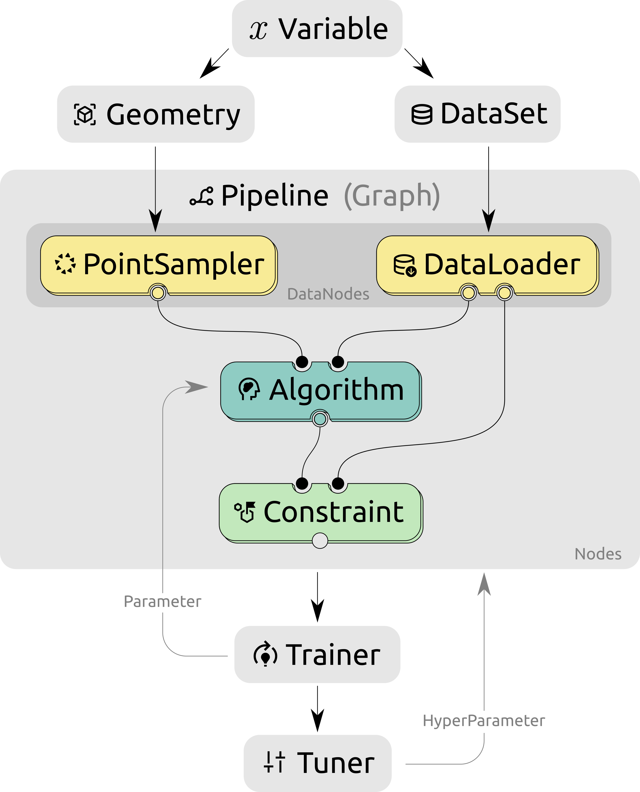

# Qewton: Deep Learning for Physics and Engineering

In Qewton, the goal is to provide easy-to-use but powerful deep learning tools for physics and engineering to everyone, lowering the barrier to entry the field of AI for simulations in any imaginable application. We pre-implement methods such as
 - Operator Learning (Fourier Neural Operators, PCA-Nets, DeepONets)
 - Differentiable Physics (WIP)
 - PINNs (Physics-Informed Neural Networks)
 - and many more to come.

To simplify their usage, we provide
 - a graph-based API for defining and training models
 - connections to existing engineering and deep learning software
 - automatic model selection and hyperparameter tuning
 - visualization tools
 - automatic shape and data configuration checking
 - pre-implemented differential operators, equations and training pipelines.


### Note:
This library is currently in beta, therefore things are subject to change. Feel free to try, contribute and suggest features.

### Installation:
Qewton requires Python 3.10 or newer. Deep learning backends and other features are optional extras. For training models you will want a backend, e.g. PyTorch:
```bash
pip install "qewton[torch]"
```
Extras can be combined with commas, e.g. PyTorch together with Gmsh for meshing CAD files:
```bash
pip install "qewton[torch,gmsh]"
```

| Extra         | Installs                                   | Enables                                                  |
|---------------|--------------------------------------------|----------------------------------------------------------|
| *(base)*      | numpy, matplotlib, tqdm, meshio, ipykernel | the core library                                         |
| `torch`       | torch                                      | the PyTorch backend                                      |
| `gmsh`        | gmsh                                       | meshing CAD files like STEP/STL (`create_mesh_geometry`) |
| `plotly`      | plotly, kaleido, shapely                   | the Plotly renderer and static image export              |
| `dash`        | dash, plotly                               | interactive figures as a web app (`DashApplication`)     |
| `widgets`     | ipywidgets, ipympl                         | interactive figures in Jupyter (`WidgetApplication`)     |
| `tuning`      | optuna, pandas                             | `OptunaTuner` and `TuningAnalyzer`                       |
| `tensorboard` | tensorboard                                | `TensorboardLogger` (together with `torch`)              |
| `hdf5`        | h5py                                       | `HDF5DataSet`                                            |
| `all`         | all of the above                           |                                                          |

The quotes keep shells like zsh from interpreting the brackets. On Linux, the Gmsh package needs a few system libraries such as libGLU (e.g. `apt install libglu1-mesa`). To use a specific PyTorch build (e.g. CPU-only or a certain CUDA version), install PyTorch first following [pytorch.org](https://pytorch.org/get-started/locally/), then install Qewton with the extras you need.

To install the latest development version from GitHub:
```bash
pip install "qewton[torch] @ git+https://github.com/Qewton-Labs/Qewton.git"
```

### Structure:
The core structure of Qewton is based on few key components:
<picture>
  <source media="(prefers-color-scheme: dark)" srcset="https://raw.githubusercontent.com/Qewton-Labs/Qewton/main/images/struktur_dark.png">
  
</picture>

### About us:
We are the creators of [TorchPhysics](https://github.com/qewton-labs/torchphysics), a deep learning library for PDEs. With Qewton, we aim to provide a more user-friendly and flexible framework for deep learning in physics and engineering.